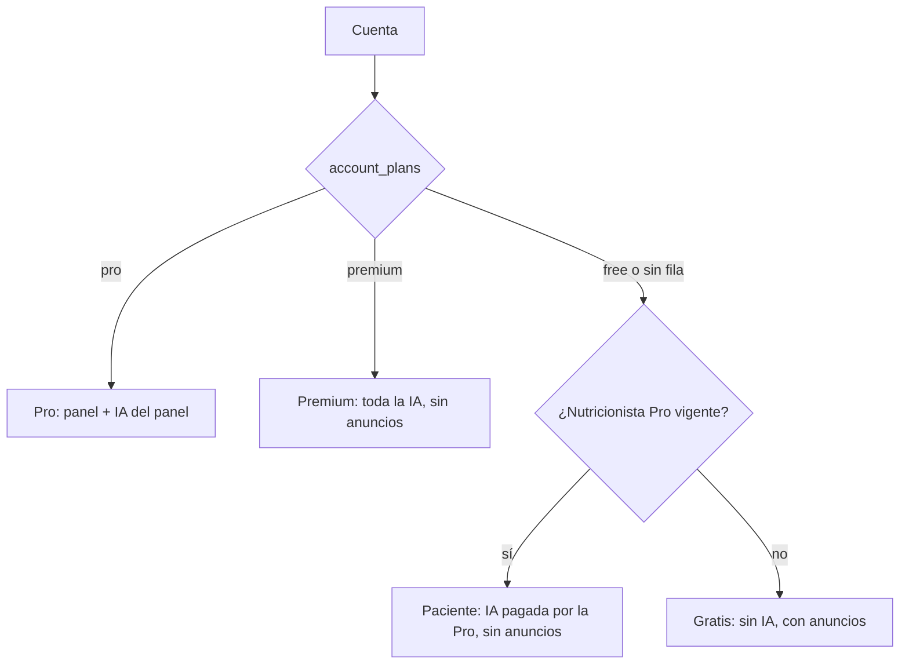

# Planes de Ceres

Interno · 14 de noviembre de 2026 · etapa 5 de `docs/roadmap-tesis.md`.

**La regla:** todo lo que usa IA o hace análisis es pago. El plan gratis tiene
el registro completo, sin IA, y es el único con anuncios. Premium vende
tiempo (cargar con una foto) y lectura (qué dicen tus números), nunca el
acceso a tus propios datos.

La compra es simulada (`demo_switch_plan`, solo cuentas `@demo.ceres.app`).

## Quién tiene qué

| | Gratis | Premium | Paciente de una Pro | Pro | Consultorio |
|---|:-:|:-:|:-:|:-:|:-:|
| **Para quién** | Persona | Persona | Persona con nutricionista | Nutricionista | Consultorio o clínica |
| **Precio orientativo** | US$ 0 | US$ 4,99/mes · 39,99/año | Lo paga la Pro | US$ 49/mes hasta 30 pacientes | Por profesional, facturación central |
| Registro: comidas (catálogo, código de barras, manual), actividad, peso, medidas, agua, sueño, contexto | ✓ | ✓ | ✓ | — | — |
| Historial, gráficos de progreso, informe PDF del período | ✓ | ✓ | ✓ | — | — |
| Pals, vincularse a una nutricionista | ✓ | ✓ | ✓ | — | — |
| **IA:** foto, texto o voz, «¿Qué como?», recalcular, objetivo con IA | — | ✓ | ✓ | — | — |
| **Análisis:** resumen semanal y reporte del período con IA | — | ✓ | ✓ | — | — |
| Devoluciones, comentarios por comida, objetivo recomendado, artículos | Recibe | Recibe | Recibe | Escribe | Escribe |
| Anuncios | **Sí** | No | No | No | No |
| Panel: equipo con avisos, ficha completa, alta y baja de pacientes | — | — | — | ✓ | ✓ |
| **Análisis de consulta:** balance contra peso, horarios, alimentos, semanas, cintura/altura, días bajo el basal, días con alcohol o enfermedad | — | — | — | ✓ | ✓ |
| **IA del panel:** informe de consulta, borrador de devolución, análisis del equipo | — | — | — | ✓ | ✓ |
| IA incluida para sus pacientes (fondo mensual de análisis) | — | — | — | 1.800/mes | Fondo compartido |
| Administrar el consultorio: pacientes de todas, reasignar, números del consultorio, sumar profesionales | — | — | — | — | ✓ |

## Cómo se decide el plan de cada uno

Lo calcula la base (`effective_plan()`, migraciones 49 y 55), no la app. La app
solo se anticipa para no ofrecer un botón que el servidor va a rechazar con un
402.

- Sin nutricionista cada uno vuelve a su plan: si la IA se la pagaba la Pro,
  queda en Gratis; si pagaba Premium, sigue en Premium (migración 55).
- Las funciones con IA del servidor contestan 402 a un plan que no las incluye,
  venga de donde venga el pedido.

## La publicidad (simulada)

Las reglas, que valen para el día que haya anuncios de verdad:

1. **Solo en el plan gratis.** Ni Premium, ni pacientes de una Pro, ni el panel.
   Una nutricionista no recomendaría una app que les muestra anuncios a sus
   pacientes.
2. **Solo en pantallas neutras:** Historial, el buscador de alimentos y
   Progreso. Nunca en Inicio, en el balance del día, en el peso ni en el
   formulario de una comida: un anuncio al lado de "te quedan 300 kcal" se lee
   como un comentario sobre eso.
3. **Contextuales, nunca segmentados con datos de salud.** Lo que se muestra
   depende de la pantalla, jamás de lo que la persona comió, pesó o se
   propuso. Ningún dato del registro sale hacia un anunciante.
4. **Rubros prohibidos:** pastillas para adelgazar, «detox», dietas milagro,
   suplementos con promesas, alcohol.
5. **Siempre con la salida a la vista:** cada anuncio dice "Anuncio" y tiene
   "Quitar anuncios", que lleva a Planes.
6. **Es un complemento.** Su función real es empujar hacia Premium, no ganar
   plata con impresiones.

Dónde está en el código: `lib/presentation/components/plan/ad_banner.dart`
(anuncios y rubros), `lib/presentation/components/plan/ai_gate.dart` (el aviso
de Premium donde iría la IA), `lib/domain/models/plan.dart` (`includesAi`,
`showsAds`).

## Decisiones para revisar

- **Gráficos de Progreso y PDF del período, en Gratis.** El plan de la tesis
  (v2.2) ponía el PDF en Premium, y la pantalla Planes de la app lo lista en
  Gratis. Quedó en Gratis: es tu registro exportado, no análisis ni IA.
  "Análisis" premium = el resumen semanal y el reporte del período (con IA) en
  la app, y el análisis de consulta en el panel.
- **Sin tope diario de IA en Premium** (el plan hablaba de 20 por día): hoy
  manda la cuota del servidor (`check_rate_limit`).
- **Sin prueba gratis de 7 días:** está en el plan de negocio pero no en la app.
