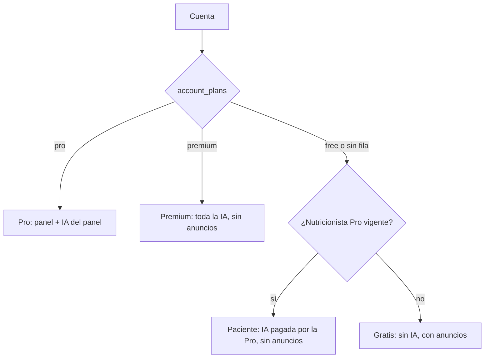

# Planes de Ceres

Interno · 14 de noviembre de 2026 · etapa 5 de `docs/roadmap-tesis.md`.

**La regla:** todo lo que usa IA o hace análisis es pago. El plan gratis tiene
el registro completo, sin IA, y es el único con anuncios. Premium vende
tiempo (cargar con una foto) y lectura (qué dicen tus números), nunca el
acceso a tus propios datos.

La compra es simulada (`demo_switch_plan`, solo cuentas `@demo.ceres.app`).

## Quién tiene qué

| | Gratis | Premium | Paciente de una Pro | Pro | Consultorio |
|---|:-:|:-:|:-:|:-:|:-:|
| **Para quién** | Persona | Persona | Persona con nutricionista | Nutricionista | Consultorio o clínica |
| **Precio orientativo** | US$ 0 | US$ 4,99/mes · 49,99/año | Lo paga la Pro | US$ 49/mes hasta 30 pacientes activos | US$ 45 por profesional (desde 3) |
| Registro: comidas (catálogo, código de barras, manual), actividad, peso, medidas, agua, sueño, contexto | ✓ | ✓ | ✓ | — | — |
| Historial, gráficos de progreso, informe PDF del período | ✓ | ✓ | ✓ | — | — |
| Pals, vincularse a una nutricionista | ✓ | ✓ | ✓ | — | — |
| **IA:** foto, texto o voz, «¿Qué como?», recalcular, objetivo con IA | — | ✓ | ✓ | — | — |
| **Análisis:** resumen semanal y reporte del período con IA | — | ✓ | ✓ | — | — |
| Devoluciones, comentarios por comida, objetivo recomendado, artículos | Recibe | Recibe | Recibe | Escribe | Escribe |
| Anuncios | **Sí** | No | No | No | No |
| Panel: equipo con avisos, ficha completa, alta y baja de pacientes | — | — | — | ✓ | ✓ |
| **Análisis de consulta:** balance contra peso, horarios, alimentos, semanas, cintura/altura, días bajo el basal, días con alcohol o enfermedad | — | — | — | ✓ | ✓ |
| **IA del panel:** informe de consulta, borrador de devolución, análisis del equipo | — | — | — | ✓ | ✓ |
| Créditos de IA por mes | 10 de bienvenida (14 días) | 150 | Del fondo de la Pro | 1.200 (pacientes + panel) | Fondo compartido, 40 por paciente |
| Administrar el consultorio: pacientes de todas, reasignar, números del consultorio, sumar profesionales | — | — | — | — | ✓ |

## Cómo se decide el plan de cada uno

Lo calcula la base (`effective_plan()`, migraciones 49 y 55), no la app. La app
solo se anticipa para no ofrecer un botón que el servidor va a rechazar con un
402.

- Sin nutricionista cada uno vuelve a su plan: si la IA se la pagaba la Pro,
  queda en Gratis; si pagaba Premium, sigue en Premium (migración 55).
- Las funciones con IA del servidor contestan 402 a un plan que no las incluye,
  venga de donde venga el pedido.

## La publicidad (simulada)

Las reglas, que valen para el día que haya anuncios de verdad:

1. **Solo en el plan gratis.** Ni Premium, ni pacientes de una Pro, ni el panel.
   Una nutricionista no recomendaría una app que les muestra anuncios a sus
   pacientes.
2. **Solo en pantallas neutras:** Historial, el buscador de alimentos y
   Progreso. Nunca en Inicio, en el balance del día, en el peso ni en el
   formulario de una comida: un anuncio al lado de "te quedan 300 kcal" se lee
   como un comentario sobre eso.
3. **Contextuales, nunca segmentados con datos de salud.** Lo que se muestra
   depende de la pantalla, jamás de lo que la persona comió, pesó o se
   propuso. Ningún dato del registro sale hacia un anunciante.
4. **Rubros prohibidos:** pastillas para adelgazar, «detox», dietas milagro,
   suplementos con promesas, alcohol.
5. **Siempre con la salida a la vista:** cada anuncio dice "Anuncio" y tiene
   "Quitar anuncios", que lleva a Planes.
6. **Es un complemento.** Su función real es empujar hacia Premium, no ganar
   plata con impresiones.

Dónde está en el código: `lib/presentation/components/plan/ad_banner.dart`
(anuncios y rubros), `lib/presentation/components/plan/ai_gate.dart` (el aviso
de Premium donde iría la IA), `lib/domain/models/plan.dart` (`includesAi`,
`showsAds`).

## Decisiones para revisar

- **Gráficos de Progreso y PDF del período, en Gratis.** El plan de la tesis
  (v2.2) ponía el PDF en Premium, y la pantalla Planes de la app lo lista en
  Gratis. Quedó en Gratis: es tu registro exportado, no análisis ni IA.
  "Análisis" premium = el resumen semanal y el reporte del período (con IA) en
  la app, y el análisis de consulta en el panel.
- **Sin tope diario de IA en Premium** (el plan hablaba de 20 por día): hoy
  manda la cuota del servidor (`check_rate_limit`).
- **Sin prueba gratis de 7 días:** está en el plan de negocio pero no en la app.

## Costos y créditos (15 de noviembre de 2026)

Los números están en `docs/costos-y-precios.xlsx` (supuestos editables) y en
la sección "Costos, precios y rentabilidad" del deck. Lo que cambia respecto
de lo de arriba, **propuesto y sin implementar**:

- **La IA se factura en créditos.** Foto, texto, recalcular, «¿Qué como?»,
  objetivo, resumen y borrador = 1; informe de consulta = 2; análisis del
  equipo = 3. Cada crédito sale de un saldo con dueño: fondo de la Pro →
  créditos del mes de Premium → paquetes → bienvenida. Sin saldo, 402.
- **Paquetes:** 30 créditos US$ 1,49 y 100 por US$ 3,99 (tienda); para la
  Pro, paciente extra US$ 1,50 (+40) y 500 créditos por US$ 19 (web).
- **El fondo de la Pro baja de 1.800 a 1.200** (40 por paciente activo). La
  base todavía trae 1.800 (`organizations.ai_monthly_quota`).
- **Paciente facturable** = vinculado, con permiso vigente y al menos un
  registro en el mes.
- **Antes del 1/1/2027:** caché de contexto para la tabla SARA (Google duplica
  la tarifa de Gemini 3.6 Flash ese día) y evaluar Claude Haiku 5.5 como
  respaldo en lugar de Opus 5, que cuesta ~7 veces un análisis de Gemini.

## Plan comercial (15 de noviembre de 2026)

Las nueve preguntas de la defensa, contestadas. Las cifras salen de
`docs/costos-y-precios.xlsx`; lo marcado *propuesto* no está construido.

1. **Qué es pago:** todo lo que usa IA o analiza (foto, texto, voz,
   recalcular, «¿Qué como?», objetivo con IA, resumen semanal, informe de
   consulta, análisis del equipo) y el panel. Registrar, ver el historial,
   exportar el PDF y recibir devoluciones es gratis.
2. **Publicidad:** solo cuentas Gratis sin nutricionista, solo en Historial,
   Progreso y el buscador. Nunca a pacientes de una Pro ni en el panel.
3. **Planes para personas:** Premium US$ 4,99/mes o 49,99/año con 150
   créditos; paquetes de 30 por US$ 1,49 y 100 por US$ 3,99. Margen típico
   44 % (mensual) y 37 % (anual).
4. **Nutricionistas:** Pro US$ 49/mes con 30 pacientes activos (US$ 1,63
   c/u), paciente extra US$ 1,50, Consultorio US$ 45 por profesional desde
   tres. Solo se cobra el paciente activo (registró algo en el mes).
5. **Recursos:** el fondo es de 40 créditos por paciente activo (1.200 con
   30) y lo comparten pacientes y panel. Más paga, más créditos: +40 por
   paciente extra, +500 por US$ 19. *Propuesto:* tope por paciente
   configurable, consumo visible y aviso antes de cortar.
6. **Usos:** Gratis, 10 créditos de bienvenida (14 días); Premium, 150 por
   mes; paciente, 40 por mes del fondo. Los créditos se renuevan **por mes**,
   sin acumular; los paquetes vencen a los 12 meses. El tope diario (20
   análisis, 5 resúmenes, 40 informes, 60 búsquedas) es solo contra el
   abuso. **Hoy se reinicia a las 21 h de Argentina** porque usa la fecha UTC
   del servidor (`current_date` en `check_rate_limit`): pasarlo a la
   medianoche local.
7. **Costos:** servicios US$ 120 / 152 / 293 por mes con 500 / 5.000 / 20.000
   usuarios activos; IA ≈ US$ 0,022 por crédito con la tarifa de 2027 y caché.
8. **Modelos:** Gemini 3.6 Flash para todo; Claude Opus 5 de respaldo solo si
   Gemini no devuelve nada (2 intentos en 50 s, 1 de Claude en 28 s). No se
   cambia por costo pedido a pedido, para que los números sean comparables
   entre semanas. Modelo y versión del prompt se cambian por variable del
   servidor, sin publicar la app.
9. **Tiendas:** Google Play US$ 25 una vez; Apple US$ 99 por año; comisión de
   15 % en suscripciones y paquetes. Las profesionales pagan por la web
   (Mercado Pago, 7,25 %).

La presentación de la defensa (30 láminas) está fuera del repositorio, en
`Desktop\Ceres-presentacion\`.
